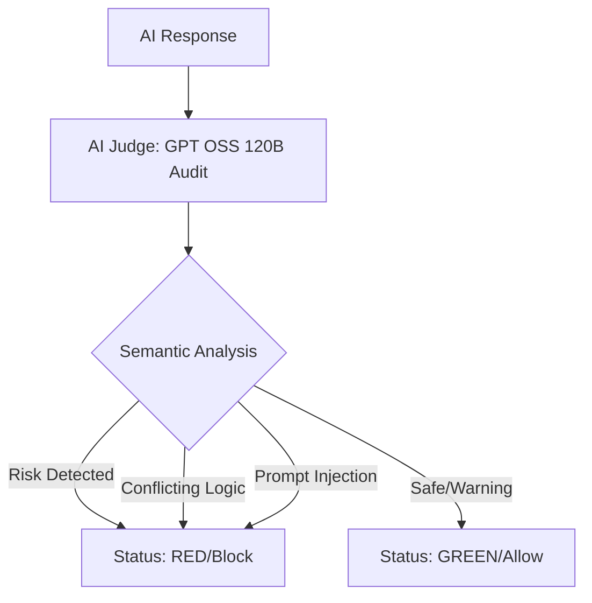

# MediTrust AI: Hybrid Medical Safety Firewall

A sophisticated two-layer verification system designed to prevent AI-generated medical hallucinations and safety violations. Features an advanced **Agentic Reflection Loop** that continuously challenges and self-corrects the primary AI until a safe, deterministic clinical response is generated.

## 🧠 Philosophy: Zero-Error Clinical Mindset
Inspired by years of systemic data auditing in high-stakes environments, this tool treats AI hallucinations not as software bugs, but as critical medical threats.

**Real-world discovery:**
During testing, the AI Judge successfully flagged **'500ml Saline'** for a renal failure patient as a risk for fluid overload—a nuance missed by standard filters but captured by our **Semantic Layer**.

## 🏗️ Architecture: Pure Semantic Firewall & Agentic Loop
Unlike systems relying on fragile "keyword lists", MediTrust utilizes a strict **Binary Decision Architecture** with Agentic Feedback:

- **Zero-Trust Logic**: Every response is treated as potentially risky until verified.
- **Strict Binary Routing**: The AI Judge makes a definitive "Block" or "Allow" decision. (No "Alert Doctor" escape hatches).
- **Agentic Reflection**: If blocked, the system feeds the reasoning back to the primary LLM to regenerate a medically safe response (up to 3 attempts).
- **Deterministic Output**: Uses GPT OSS 120B (temperature: 0) to ensure consistent, JSON-formatted safety verdicts.

## ⚙️ LLM Observability & CI/CD
To ensure continuous safety, this project integrates a fully automated **LLM Observability Pipeline**:
- **Automated Test Runner**: Validates the AI Judge against a strict baseline of medical edge cases, negations, and prompt injection (Jailbreak) attacks.
- **Continuous Integration (GitHub Actions)**: Every push triggers a semantic regression and E2E integration test suite to guarantee zero degradation in safety logic.
- **Automated Reporting**: Generates detailed markdown audit logs tracking AI reasoning and routing decisions.

## 🛠️ Tech Stack
- **Python 3.10+**
- **AI/LLM:** GPT OSS 120B (Groq API)
- **DevOps/QA:** GitHub Actions (CI/CD), Automated Semantic Testing
- **Security:** Dotenv API protection, Secure Logging

## 🚀 Getting Started
1. Clone the repository.
2. Install dependencies: `pip install groq python-dotenv`.
3. Create a `.env` file with your `GROQ_API_KEY`.
4. Run the Agentic production simulation: `python app.py`
5. Run the CI/CD test suite locally: `python tests/test_runner.py`